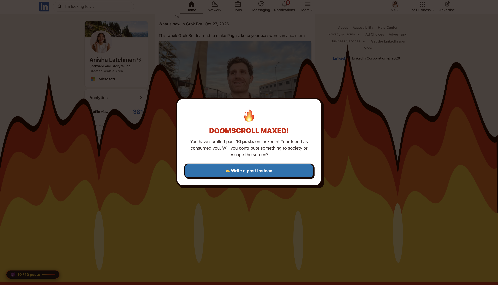

# LinkedIn Anti-Doomscroll

A Chrome extension that turns your LinkedIn doomscrolling into flames once you scroll past 10 posts. Prompts you to create a post instead.



---

## 🛠️ How to Install in Google Chrome

1. Open Google Chrome and navigate to:
   ```text
   chrome://extensions/
   ```
2. In the top-right corner, switch on **Developer mode**.
3. Click the **Load unpacked** button in the top-left corner.
4. Download and select this project folder
5. Navigate to [linkedin.com/feed](https://www.linkedin.com/feed/).
6. Start scrolling and watch the flames rise!

---

## 📜 License
MIT License. Built to help break the scroll and inspire creation!
